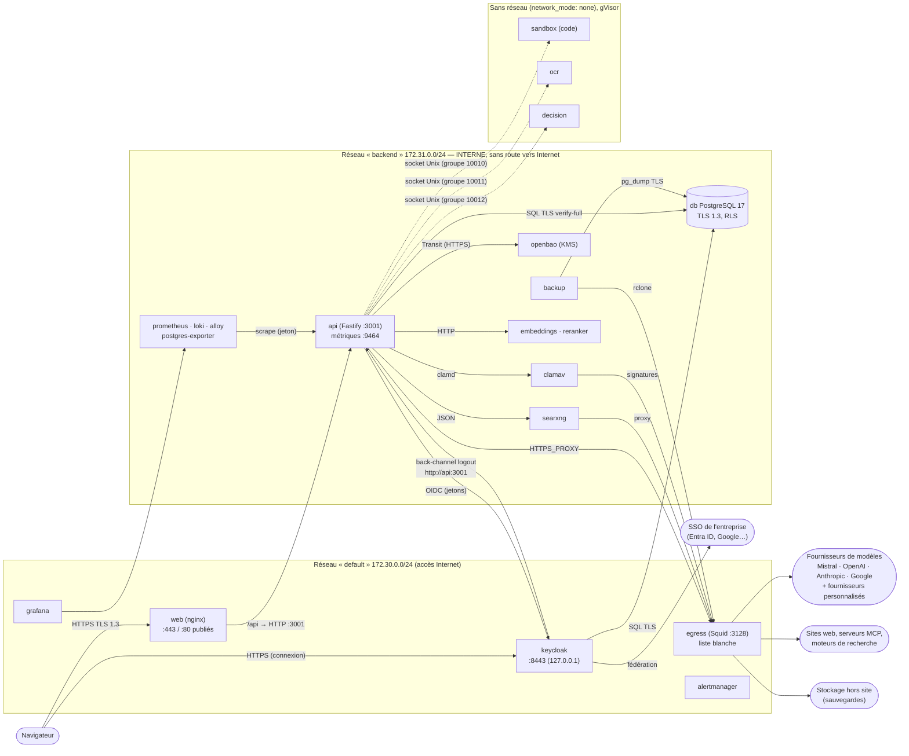

# Architecture de Snowfall — vue d'ensemble (20 novembre 2026)

Ce document décrit **ce qui tourne**, **où**, et **qui parle à qui**. Il est
complété par :

| Document | Contenu |
|---|---|
| [FLUX.md](FLUX.md) | Les parcours pas à pas (connexion, question, document, connecteur, clés), en diagrammes de séquence |
| [SECURITE.md](SECURITE.md) | L'architecture de sécurité, couche par couche, avec les fichiers qui l'implémentent |
| [DONNEES.md](DONNEES.md) | Le modèle de données : tables, chiffrement colonne par colonne, cloisonnement (RLS) |
| [../security/THREAT_MODEL.md](../security/THREAT_MODEL.md) | Les menaces et leur traitement (registre) |
| [../security/SECURITY_BASELINE.md](../security/SECURITY_BASELINE.md) | Les exigences de sécurité (socle) |
| [../operations/RUNBOOK.md](../operations/RUNBOOK.md) | L'exploitation au quotidien |

Les schémas sont en Mermaid (affichés par GitHub et par VS Code avec l'extension
« Markdown Preview Mermaid Support »).

---

## 1. En une phrase

Snowfall est un **espace de travail d'IA pour une organisation** : des
conversations avec des modèles (Mistral, OpenAI, Anthropic, Google, un modèle
local ou un fournisseur personnalisé), des **agents** équipés d'outils (bases de
connaissances, recherche web, exécution de code, connecteurs MCP, génération
d'images, délégation), le tout **multi-organisation**, chiffré, cloisonné et
journalisé.

## 2. Les briques

| Brique | Technologie | Rôle |
|---|---|---|
| **web** | React 19 + Vite 8 (`apps/web`), servi par **nginx** en production | L'interface. Ne détient aucun secret : pas de jeton, pas de clé. Parle à l'API via `/api` (même origine). |
| **api** | Node.js 24, **Fastify 5**, TypeScript, Drizzle ORM (`apps/api`) | Le cœur : **BFF** (Backend For Frontend) qui détient la session, toute la logique métier, les appels aux modèles, l'orchestration des agents avec **LangGraph** (`StateGraph`, `graph/chat-graph.ts`). |
| **db** | **PostgreSQL 17** | Toutes les données. Cloisonnement par **RLS** (Row-Level Security), colonnes sensibles chiffrées par l'API (la base ne voit que du chiffré). |
| **keycloak** | Keycloak (realm importé, `infra/keycloak`) | Identité : connexion, MFA, SSO d'entreprise (fédération), organisations. Protocole **OpenID Connect**. |
| **egress** | **Squid** (`infra/egress`) | Le **seul** chemin vers Internet du réseau interne, avec liste blanche de domaines. |
| **clamav** | ClamAV | Antivirus des fichiers déposés. |
| **openbao** *(profil kms)* | OpenBao (fork libre de Vault), moteur Transit | KMS : garde la clé maîtresse (KEK) ; l'API ne voit jamais la KEK. |
| **sandbox** *(profil code)* | Python isolé par **gVisor** (`apps/sandbox`) | Exécution du code écrit par les agents (analyses, fichiers Office). Aucun réseau. |
| **ocr** *(profil ocr)* | Tesseract + Poppler isolés par gVisor (`apps/ocr`) | Lecture des PDF numérisés et images. Aucun réseau. |
| **decision** *(profil decision)* | Petit modèle local (`apps/decision`) | Routage des questions vers un modèle « rapide » ou « fort ». Aucun réseau. |
| **searxng** *(profil web-search)* | SearXNG | Métamoteur privé pour l'outil de recherche web des agents. |
| **embeddings / reranker** *(profil local-ai)* | Text Embeddings Inference (BAAI/bge-m3, bge-reranker-v2-m3) | Vecteurs et reclassement **sur la plateforme** (obligatoires pour les bases confidentielles). |
| **backup / backup-verify** | pg_dump + age + rclone (`infra/backup`) | Sauvegarde chiffrée quotidienne, copie hors site, test de restauration mensuel. |
| **prometheus, alertmanager, loki, alloy, grafana, postgres-exporter** | Pile de supervision (`infra/monitoring`) | Métriques, alertes, journaux, tableaux de bord. |
| **langfuse** *(facultatif)* | Langfuse auto-hébergé (`infra/langfuse`) | Traces des appels aux modèles (observabilité IA). |
| **speaches / localai** *(dev, profils voice / images)* | Services compatibles OpenAI | Dictée et lecture vocale, génération d'images en local. |

## 3. Schéma de déploiement (production)

`docker compose -f compose.yaml -f compose.prod.yaml up -d`



Lecture du schéma :
- **Un seul point d'entrée applicatif** : nginx (443). L'API, la base et le KMS
  ne sont **pas** joignables depuis Internet, et n'ont **pas** de route vers
  Internet : le réseau `backend` est déclaré `internal: true`.
- **Une seule sortie** : `egress` (Squid), qui refuse toute adresse interne et
  n'autorise que les domaines listés dans `infra/egress/*.txt`.
- **Trois services sans aucune interface réseau** (sandbox, ocr, decision) : ils
  reçoivent les demandes de l'API par des **sockets Unix** sur des volumes
  partagés, réservés à un groupe système.
- Keycloak est sur les deux réseaux : il doit joindre l'IdP d'entreprise et le
  SMTP (public), la base et l'API (interne).

## 4. Matrice des communications

| De | Vers | Protocole / port | Authentification | Remarque |
|---|---|---|---|---|
| Navigateur | nginx | HTTPS 443 (TLS 1.3 seul, HSTS) | Cookie de session `__Host-…` (HttpOnly, Secure, SameSite=Strict) | 80 redirige vers 443 |
| Navigateur | Keycloak | HTTPS | Identifiants + MFA, ou SSO | Seulement pendant la connexion |
| nginx | api | HTTP 3001 (réseau interne) | Cookie transmis ; en-tête `X-Snowfall-Internal` **vidé** par nginx | `proxy_buffering off` (flux SSE), 300 s |
| api | Keycloak | HTTPS (OIDC) | Client confidentiel `snowfall-bff` (secret) | Code + PKCE, rafraîchissement toutes les 4 min |
| Keycloak | api | HTTP 3001 `/auth/backchannel-logout` | Jeton de déconnexion signé (vérifié) | Déconnexion côté IdP → session coupée |
| api | db | PostgreSQL TLS 1.3 `verify-full` | Rôle `snowfall_app` (SCRAM), **soumis à la RLS** | Contexte posé par transaction (`db/tenant.ts`) |
| migrate | db | idem | Rôle `snowfall_migrator` (propriétaire du schéma) | Ponctuel, profil `migrate` |
| api | openbao | HTTPS (AC privée) | AppRole : `role_id` + `secret_id` (fichier secret) | Chiffre/déchiffre les clés d'organisation |
| api | clamav | clamd (TCP interne) | Réseau interne | Chaque fichier déposé |
| api | sandbox / ocr / decision | Socket Unix | Permissions du fichier (groupes 10010/10011/10012) | Aucun réseau côté service |
| api | searxng | HTTP JSON (172.31.0.20) | Réseau interne | Recherche web des agents |
| api | embeddings / reranker | HTTP (réseau interne) | Réseau interne | Profil `local-ai` |
| api | Fournisseurs de modèles | HTTPS via egress | Clé d'API (plateforme, organisation, personnelle) | Domaines dans `allowed-domains.txt` |
| api | Serveurs MCP | HTTPS via egress (CONNECT) | OAuth 2.1 (jeton par personne) ou jeton | Domaines dans `mcp-domains.txt` |
| api | Pages web (bases de connaissances) | HTTPS via egress | — | Domaines dans `knowledge-domains.txt` |
| searxng | Moteurs de recherche | HTTPS via egress | — | Autorisé **seulement** depuis 172.31.0.20 |
| clamav | Signatures | HTTPS via egress | — | `.clamav.net` |
| backup | db, stockage hors site | TLS / HTTPS via egress | Mot de passe (secret), rclone (secret) | Sauvegardes chiffrées **avant** de sortir (age) |
| prometheus | api :9464 | HTTP interne | Jeton `METRICS_TOKEN` | Plus le réseau |
| Applications tierces | nginx → api `/v1/*` | HTTPS | Clé d'API (empreinte SHA-256 en base) | API publique des agents |
| Annuaire d'entreprise | nginx → api `/scim/v2` | HTTPS | Jeton SCIM dédié | Provisionnement des comptes |

## 5. Développement local

`docker compose up -d` lance db, keycloak, mailpit (et les profils demandés),
puis :

| Commande | Rôle | Adresse |
|---|---|---|
| `npm run db:migrate` | Migrations Drizzle + droits du rôle applicatif | — |
| `npm run dev:api` | API en rechargement automatique (`tsx watch`) | http://localhost:3001 |
| `npm run dev:web` | Interface (Vite), qui relaie `/api` vers l'API | http://localhost:5173 |

| Service dev | Port local | Profil |
|---|---|---|
| PostgreSQL | 127.0.0.1:5434 | — |
| Keycloak | 127.0.0.1:8080 | — |
| Mailpit (courriels de test) | 127.0.0.1:8025 | — |
| ClamAV | 127.0.0.1:3310 | `antivirus` |
| SearXNG | 127.0.0.1:8888 | `web-search` |
| socket-bridge (sandbox / ocr / decision exposés en TCP local) | 127.0.0.1:7811-7813 | `code`, `decision` |
| speaches (voix) | 127.0.0.1:8000 | `voice` |
| localai (images) | 127.0.0.1:8090 | `images` |

Différences avec la production : pas de réseau interne ni de proxy de sortie,
pas de TLS, KEK dérivée d'une clé locale (`KMS_PROVIDER=local`), modèle « echo »
de secours si aucun fournisseur n'est configuré (refusé en production).

## 6. Structure du code

```
apps/
  api/                Fastify + TypeScript
    src/server.ts     Assemblage : dépendances, middlewares, routes, exécution des runs
    src/routes/       Routes par domaine (admin, knowledge, mcp, model-keys, public-api, scim…)
    src/auth/         OIDC (BFF), sessions, annuaire des identités
    src/db/           Schéma Drizzle (55 tables), pool, contexte RLS (tenant.ts)
    src/crypto/       Chiffrement d'enveloppe, trousseau par organisation, KMS, rotation
    src/graph/        Graphe de conversation (modèle ↔ outils), points de reprise
    src/agent/        Outils des agents, runs durables, garde-fous (injection, fidélité, exposition)
    src/llm/          Adaptateurs Mistral/OpenAI/Anthropic/Google/local/personnalisé, registre, clés
    src/knowledge/    Bases de connaissances : import, découpe, embeddings, recherche hybride
    src/mcp/          Client MCP, OAuth, OpenAPI → outils
    src/security/     Données sensibles, injection, antivirus, neutralisation
    src/privacy/      Pseudonymisation
    src/audit/        Journal d'audit (ajout seul) + export SIEM
    src/workspace/    Réglages d'organisation, quotas, budgets, membres
    src/…             conversations, agents, projects, prompts, skills, memory, shares, schedules…
    drizzle/          Migrations SQL (une par évolution)
    scripts/          db-setup, db-grants, rotation des clés, purge, évaluations
  web/                React + Vite
    src/App.tsx       État global, conversation active
    src/components/   Sidebar (barre latérale et panneaux), ConversationPanel, AgentStudio…
    src/lib/api.ts    Client de l'API (seul point d'accès réseau du navigateur)
    e2e/              Parcours Playwright (faux serveur : mock-api.ts), bureau et mobile
  sandbox/ ocr/ decision/   Services isolés (Python), un socket Unix chacun
infra/                nginx, egress, keycloak, openbao, clamav, searxng, backup, monitoring, langfuse
docs/                 architecture, security, operations, learning (fiches de cours)
```

## 7. Choix d'architecture structurants

| Choix | Pourquoi | Conséquence |
|---|---|---|
| **BFF** : l'API détient la session OIDC | Aucun jeton dans le navigateur : un XSS ne peut pas voler de jeton | Toute requête passe par l'API ; cookie de session `HttpOnly` |
| **RLS PostgreSQL** + contexte par transaction | Le cloisonnement ne dépend pas d'un `WHERE` oublié dans le code | Le rôle applicatif ne voit que les lignes de l'organisation (et de la personne) en cours |
| **Chiffrement applicatif** des colonnes sensibles | Une copie de la base (sauvegarde volée, accès DBA) ne révèle pas le contenu | Pas de recherche SQL sur ces colonnes : la recherche se fait en mémoire après déchiffrement |
| **Recherche hybride en mémoire** (BM25 + cosinus, fusion RRF) | Les vecteurs aussi sont chiffrés ; aucun index externe | Coût en mémoire borné par base ; pas de pgvector |
| **Runs durables** : une réponse est un enregistrement, la connexion ne fait qu'observer | Fermer l'onglet n'arrête rien ; reprise après redémarrage ; pause pour validation | Bail renouvelé, reprise par une autre instance, points de reprise chiffrés |
| **Réseau interne + proxy de sortie** | Une compromission de l'API ne donne pas un accès libre à Internet (exfiltration, SSRF) | Tout nouveau domaine externe s'ouvre explicitement dans `infra/egress` |
| **Services d'analyse sans réseau + gVisor** | Code d'agent, PDF et images sont des entrées non fiables | Communication par socket Unix seulement |
| **Registre de modèles par personne** (`modelsFor`) | Clés d'organisation, clés personnelles, fournisseurs personnalisés | Caches rangés par empreinte de clé ; une clé ne sert qu'à elle-même |
