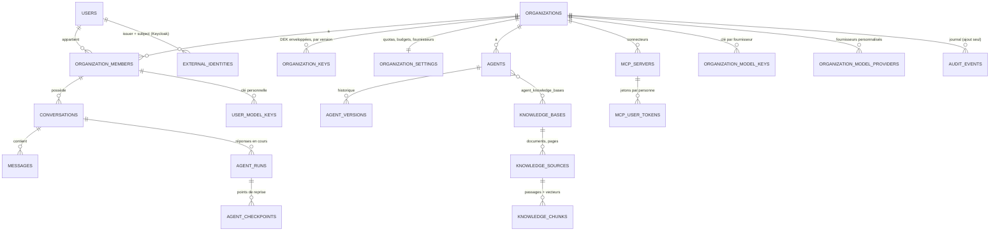

# Le modèle de données de Snowfall

Source de vérité : `apps/api/src/db/schema.ts` (Drizzle, 55 tables) et les
migrations `apps/api/drizzle/*/migration.sql` (qui ajoutent les contraintes de
chiffrement, `FORCE ROW LEVEL SECURITY` et quelques objets techniques : files de
tâches, baux des runs, index des clés d'API, vues d'activité).
Inventaire du chiffrement : `ENCRYPTED_TABLES` dans `apps/api/src/crypto/rotation.ts`.

Vue d'ensemble : [ARCHITECTURE.md](ARCHITECTURE.md) · Sécurité : [SECURITE.md](SECURITE.md).

---

## 1. Les grands ensembles

| Ensemble | Tables |
|---|---|
| **Identité et organisation** | `organizations`, `users`, `organization_members` (rôle), `external_identities`, `organization_invitations`, `member_groups`, `member_group_members`, `scim_users`, `api_keys` |
| **Session et sécurité** | `sessions`, `organization_keys`, `audit_events`, `organization_retention`, `organization_branding` |
| **Réglages et consommation** | `organization_settings`, `token_usage`, `tool_usage` |
| **Modèles** | `organization_model_keys`, `user_model_keys`, `organization_model_providers` |
| **Conversations** | `conversations`, `messages`, `message_feedback`, `conversation_summaries`, `conversation_presets`, `conversation_shares`, `attachments`, `generated_files`, `projects` |
| **Exécution des agents** | `agent_runs`, `agent_checkpoints`, `agent_checkpoint_writes`, `agent_schedules` |
| **Agents et qualité** | `agents`, `agent_versions`, `agent_eval_cases`, `agent_skills`, `skills`, `skill_files`, `skill_versions`, `prompts`, `resource_grants` (partages) |
| **Connaissances** | `knowledge_bases`, `knowledge_folders`, `knowledge_sources`, `knowledge_chunks`, `agent_knowledge_bases`, `project_knowledge_bases` |
| **Connecteurs** | `mcp_servers`, `mcp_user_tokens`, `mcp_oauth_states` |
| **Personnalisation** | `user_preferences`, `user_memories` |
| **Routage des modèles** | `decision_examples`, `decision_models` |

## 2. Cloisonnement (RLS)

Le rôle applicatif `snowfall_app` est soumis à la RLS (`NOBYPASSRLS`) et
`FORCE ROW LEVEL SECURITY` est posé sur les tables cloisonnées. L'API pose le
contexte **par transaction** (`app.organization_id`, `app.user_id`, `db/tenant.ts`).

| Portée | Règle | Tables |
|---|---|---|
| **Organisation** | `organization_id = app.organization_id` | `organization_keys`, `organization_settings`, `organization_model_keys`, `organization_model_providers`, `organization_invitations`, `token_usage`, `tool_usage`, `mcp_servers`, `agent_versions`, `agent_eval_cases`, `decision_examples`, `decision_models` |
| **Personne** (propriétaire) | organisation **et** `user_id = app.user_id` : même un administrateur ne lit pas | `conversations`, `messages`, `message_feedback`, `conversation_summaries`, `conversation_presets`, `attachments`, `generated_files`, `projects`, `agent_runs`, `agent_checkpoints`, `agent_checkpoint_writes`, `agent_schedules`, `user_preferences`, `user_memories`, `user_model_keys`, `mcp_user_tokens`, `mcp_oauth_states` |
| **Partage** | Lecture : propriétaire, partage (personne, groupe, organisation) ; écriture : propriétaire ou éditeur | `agents`, `knowledge_bases`, `prompts`, `skills` (+ `skill_files`, `skill_versions`), `resource_grants`, `conversation_shares` |
| **Contenu de base** | Lecture si la base est lisible ; écriture si elle est modifiable | `knowledge_sources`, `knowledge_folders`, `knowledge_chunks` |
| **Administrateurs** | Lecture organisation, écriture administrateurs | `member_groups`, `member_group_members`, `organization_branding`, `organization_retention`, `api_keys`, `scim_users` |
| **Sans RLS, protégées par les droits** | `organizations`, `users`, `organization_members`, `external_identities` : **lecture seule** pour l'application ; `sessions` : lue par l'**empreinte** du cookie, avant de connaître l'organisation ; `audit_events` : **INSERT seul**, déclencheurs anti-modification | |

Les droits exacts du rôle applicatif, table par table : `scripts/db-grants.ts`.

## 3. Ce qui est chiffré, colonne par colonne

Chiffrement AES-256-GCM par l'API avec la clé de l'organisation (détail dans
[SECURITE.md §4](SECURITE.md#4-protection-des-données)). La base ne voit que
`version:v1.iv.chiffré`, et une contrainte refuse toute valeur en clair.

| Table | Colonnes chiffrées | Portée de l'AAD |
|---|---|---|
| `conversations` | `title`, `instructions`, `tags` | personne |
| `messages` | `content`, `sources`, `activity` | personne |
| `message_feedback` | `comment` | personne |
| `conversation_summaries` | `summary` | personne |
| `conversation_presets` | `name`, `instructions` | personne |
| `conversation_shares` | `token`, `title`, `snapshot` | personne |
| `attachments` | `name`, `content`, `extracted_text` | personne |
| `generated_files` | `name`, `content`, `review` (nombres à vérifier) | personne |
| `projects` | `name` | personne |
| `agent_runs` | `request`, `progress` | personne |
| `agent_checkpoints` | `checkpoint`, `metadata` | personne |
| `agent_checkpoint_writes` | `value` | personne |
| `agent_schedules` | `name`, `prompt` | personne |
| `prompts` | `name`, `content` | personne |
| `skills` | `name`, `description`, `instructions` | personne |
| `skill_files` | `name`, `content`, `original` | personne |
| `skill_versions` | `description`, `instructions` | personne |
| `user_memories` | `content` | personne |
| `user_preferences` | `instructions_enc` | personne |
| `user_model_keys` | `api_key` | personne + fournisseur |
| `mcp_user_tokens` | `access_token`, `refresh_token` | personne + serveur |
| `mcp_oauth_states` | `verifier` | personne |
| `agents` | `profile_enc` (nom, instructions…) | organisation |
| `agent_versions` | `instructions_enc` | organisation |
| `agent_eval_cases` | `question`, `comment`, `rubric` | organisation |
| `member_groups` | `name` | organisation |
| `knowledge_bases` | `name`, `icon` | organisation |
| `knowledge_folders` | `name` | organisation |
| `knowledge_sources` | `name`, `url`, `content` | organisation + base |
| `knowledge_chunks` | `content`, `embedding` (le vecteur aussi) | organisation + base |
| `mcp_servers` | `url`, `token`, `tools`, `oauth`, `spec`, `icon` | organisation |
| `decision_examples` | `text_enc` | organisation |
| `decision_models` | `head_enc` | organisation |
| `organization_model_keys` | `api_key` | organisation + fournisseur |
| `organization_model_providers` | `api_key` | organisation + fournisseur + **adresse** |
| `sessions` | jetons OIDC (scellés par une clé dérivée, hors trousseau d'organisation) | session |

**Non chiffré, par choix** : identifiants, dates, rôles, compteurs de
consommation, noms de fournisseurs et de modèles, indices de clés (4 derniers
caractères), nom et adresse d'un fournisseur personnalisé (l'adresse est liée
à la clé par l'AAD), journal d'audit (qui ne contient jamais de contenu ni de
secret).

## 4. Cycle de vie

| Événement | Effet sur les données |
|---|---|
| Départ d'un membre | Suppression en cascade de ce qui est rattaché à son appartenance par clé étrangère (par exemple ses clés d'API personnelles, `user_model_keys_membership_fk`) |
| Suppression d'une organisation | Cascade sur ses tables. Les sauvegardes (35 jours) contiennent encore ses données et ses DEK enveloppées : elles disparaissent avec la rotation des sauvegardes |
| Conversation temporaire | Jamais de mémoire, purge automatique |
| Rétention | Durées par organisation (`organization_retention`) ; audit purgé au-delà de 365 jours par défaut (90 minimum) |
| Rotation des clés | `npm run keys:rotate` : nouvelle DEK, tout rechiffré, idempotent |
| Droits RGPD | Export et effacement de ses données par la personne (panneau « Mes données ») |

## 5. Contraintes notables (la base comme dernier verrou)

- Format chiffré imposé (`…_encrypted_check`) sur chaque colonne chiffrée.
- Fournisseurs autorisés : listes fermées (`agents_provider_check`,
  `conversations_model_check`, `token_usage_provider_check`…).
- Fournisseur personnalisé : `base_url` en `https://`, ≤ 500 caractères ; clé et
  indice présents ou absents ensemble.
- Indices de clés : 4 caractères alphanumériques au plus.
- Tailles bornées (noms, modèles ≤ 120 caractères, tableaux de réglages…).
- `audit_events` : déclencheurs interdisant UPDATE, DELETE, TRUNCATE.
