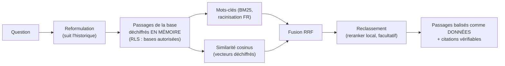
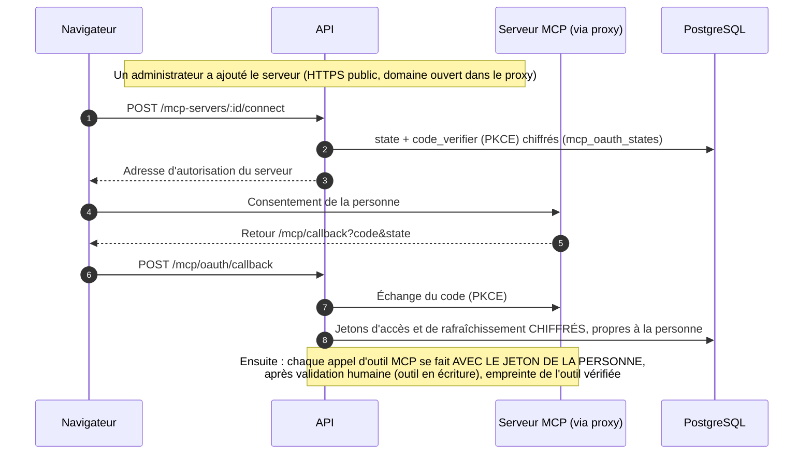
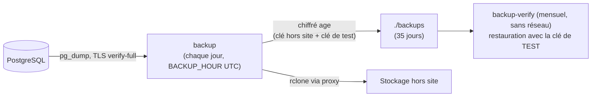

# Les flux de Snowfall, pas à pas

Chaque parcours est décrit tel qu'il est codé (routes et fichiers cités).
Vue d'ensemble : [ARCHITECTURE.md](ARCHITECTURE.md) · Sécurité : [SECURITE.md](SECURITE.md).

En production, toute requête du navigateur passe par **nginx**, qui relaie
`/api/*` vers l'API (`api:3001`) en retirant le préfixe. Les schémas omettent
nginx pour rester lisibles.

---

## 1. Connexion (OpenID Connect, modèle BFF)

Code : `apps/api/src/server.ts` (`registerLoginRoutes`), `auth/oidc.ts`, `auth/session-store.ts`.

```mermaid
sequenceDiagram
  autonumber
  participant N as Navigateur
  participant A as API (BFF)
  participant K as Keycloak
  participant D as PostgreSQL

  N->>A: GET /auth/login
  A->>A: state, nonce, code_verifier (PKCE) générés
  A-->>N: 302 vers Keycloak + cookie « login » chiffré et authentifié (transaction)
  N->>K: Page de connexion (mot de passe + MFA, ou SSO d'entreprise)
  K-->>N: 302 /auth/callback?code=…&state=…
  N->>A: GET /auth/callback (cookie « login »)
  A->>A: Déchiffre la transaction, vérifie state
  A->>K: Échange du code (client confidentiel + code_verifier)
  K-->>A: id_token, refresh_token
  A->>A: Vérifie signature, iss, aud, nonce de l'id_token
  A->>D: Identité externe (issuer, subject) → utilisateur ; appartenances (organisation, rôle)
  A->>D: Crée la session : jetons SCELLÉS (chiffrés) ; seule l'empreinte de l'identifiant est stockée
  A-->>N: 302 vers l'application + cookie __Host-session (HttpOnly, Secure, SameSite=Strict)
  Note over N,A: Le navigateur ne voit JAMAIS de jeton OIDC
```

Ensuite, à chaque requête :
- la session est relue par son empreinte ; **inactivité 30 min**, **durée max 10 h** ;
- au-delà de **4 min**, l'API rafraîchit les jetons auprès de Keycloak : un compte
  désactivé ou une session fermée côté IdP coupe la session en moins de 5 min ;
- **déconnexion côté IdP** : Keycloak appelle `POST /auth/backchannel-logout`
  (jeton de déconnexion signé, vérifié), la session est supprimée aussitôt ;
- toute requête **modifiante** doit porter l'en-tête `Origin` de l'application
  (sinon refus et événement `security.csrf_rejected`).

## 2. Une question, une réponse (run durable)

Code : `server.ts` (`POST /conversations/:id/messages`, `executeRun`, `observeRun`),
`agent/runs.ts`, `graph/chat-graph.ts`, `llm/registry.ts`.

```mermaid
sequenceDiagram
  autonumber
  participant N as Navigateur
  participant A as API
  participant D as PostgreSQL
  participant M as Fournisseur de modèle
  participant T as Outils (base, web, code, MCP…)

  N->>A: POST /conversations/:id/messages {content}
  A->>A: Session → personne, organisation, rôle ; Origin vérifiée ; limite de débit
  A->>A: Contrôles : quotas, budget, liste blanche des fournisseurs, données sensibles
  Note over A: NIR, IBAN, carte, santé détectés → modèle LOCAL exigé (sinon refus)
  A->>D: Message chiffré enregistré ; RUN créé (bail de l'instance)
  A-->>N: Flux SSE ouvert (text/event-stream)
  loop Graphe LangGraph : modèle ↔ outils
    A->>M: Messages (pseudonymisés si l'organisation l'exige), outils autorisés
    M-->>A: Jetons en flux, ou appel d'outil
    A-->>N: SSE « token » / « step »
    alt Outil en lecture (base, web, code)
      A->>T: Exécution (droits revérifiés, contenus balisés comme DONNÉES)
      T-->>A: Résultat (injection détectée → avertissement)
    else Outil en écriture (MCP, enregistrer dans une base)
      A->>D: Point de reprise chiffré ; run « en pause »
      A-->>N: SSE « approval » (carte de validation)
      N->>A: POST /conversations/:id/approvals/:approvalId {approuvé ou non}
      A->>T: Exécution seulement si approuvé
    end
    A->>D: Point de reprise chiffré après chaque étape ; bail renouvelé
  end
  A->>D: Réponse chiffrée, sources, activité ; consommation comptée
  A-->>N: SSE « done »
```

Points clés :
- **La connexion n'est qu'un spectateur** : fermer l'onglet n'arrête pas le run.
  `GET /conversations/:id/run/events` le rejoint ; `POST …/run/cancel` l'arrête.
- **Reprise** : si l'instance tombe, son bail expire et une autre instance reprend
  le run depuis le dernier point de reprise (`agent_checkpoints`, chiffré).
- **Quel modèle ?** `modelsFor(personne)` donne la vue des modèles de cette personne :
  sa clé personnelle (si l'organisation l'autorise), sinon celle de l'organisation,
  sinon celle de la plateforme ; plus les fournisseurs personnalisés de son organisation.
- **Qui paie ?** Une réponse sur clé personnelle n'est pas comptée dans le budget
  de l'organisation ; toutes les autres le sont (`token_usage`).

## 3. Ajouter un document à une base de connaissances

Code : `routes/knowledge.ts` (`POST /knowledge/bases/:id/files`, `…/links`),
`knowledge/service.ts`, `knowledge/chunk.ts`, `knowledge/embeddings.ts`.

```mermaid
sequenceDiagram
  autonumber
  participant N as Navigateur
  participant A as API
  participant C as ClamAV
  participant O as OCR (sans réseau)
  participant E as Embeddings (fournisseur ou local)
  participant D as PostgreSQL

  N->>A: POST /knowledge/bases/:id/files (≤ 25 Mo)
  A->>A: Droit d'écriture sur la base ; type détecté par le contenu (pas l'extension)
  A->>C: Analyse antivirale
  C-->>A: Sain (sinon refus « Malware detected »)
  A->>D: Source chiffrée enregistrée, tâche en file
  A-->>N: 202 (traitement en arrière-plan)
  A->>A: Extraction du texte (PDF, Office, HTML…)
  opt PDF numérisé ou image
    A->>O: Socket Unix
    O-->>A: Texte reconnu
  end
  A->>A: Découpe en passages (titres gardés comme contexte)
  alt Base confidentielle
    A->>E: Embeddings LOCAUX seulement (rien ne sort)
  else Base normale
    A->>E: Embeddings du fournisseur choisi par l'organisation (quota compté)
  end
  A->>D: Passages ET vecteurs chiffrés (AES-256-GCM, AAD : organisation, base, source)
```

Une **page web** (`…/links`) suit le même chemin, après : adresse validée
(publique, HTTPS, domaines autorisés par l'organisation), téléchargement par le
proxy de sortie, au plus 3 redirections revérifiées, puis antivirus.

## 4. Recherche dans une base (outil `search_knowledge`)

Code : `knowledge/search.ts`, `knowledge/rewrite.ts`, `knowledge/rerank.ts`.



Rien n'est confié à un index externe ni à un index de la base : les vecteurs étant
chiffrés, la recherche se fait dans l'API, après déchiffrement, puis tout est oublié.

## 5. Connecteur MCP avec OAuth (par personne)

Code : `routes/mcp.ts`, `mcp/client.ts`, `mcp/connections`.



Si un serveur change la description d'un outil après son approbation, l'empreinte
change et l'outil est bloqué jusqu'à une nouvelle approbation (protection contre
le « rug pull »).

## 6. Clés des fournisseurs et fournisseurs personnalisés

Code : `routes/model-keys.ts`, `llm/keys.ts`, `llm/custom-providers.ts`, `llm/registry.ts`.

```mermaid
flowchart TB
  subgraph saisie["Saisie (panneau Modèles)"]
    k1["Clé personnelle<br/>(si l'organisation l'autorise)"]
    k2["Clé de l'organisation<br/>(administrateur)"]
    k3["Fournisseur personnalisé<br/>(administrateur : nom, adresse, clé)"]
  end
  k1 & k2 --> chk["Vérification auprès du fournisseur<br/>(liste des modèles, 10/min/personne)"]
  k3 --> url["Adresse : HTTPS publique,<br/>sans identifiants, paramètres ni port inhabituel"] --> chk
  chk --> enc["Chiffrement (AAD : organisation,<br/>personne/fournisseur, adresse)"] --> db[("PostgreSQL<br/>RLS")]
  db --> view["modelsFor(personne) :<br/>personnelle › organisation › plateforme<br/>+ fournisseurs personnalisés"]
  view --> call["Appel au modèle<br/>(cache rangé par empreinte de clé)"]
  call -->|"personnalisé : adresse revérifiée<br/>à chaque appel, sans redirection"| proxy["Proxy de sortie"]
```

## 7. Validation humaine (approbations)

Les outils classés « écriture » (`agent/catalog.ts` : `save_to_knowledge`, `mcp`)
ne s'exécutent jamais sans un clic de la personne. La carte de validation montre
les arguments exacts, et un avertissement si le contexte contient une injection
détectée. Le run est en **pause** (aucune ressource du serveur occupée) jusqu'à la
réponse, qui peut arriver sur n'importe quelle instance.

## 8. Sauvegarde et restauration



Les données sensibles étant déjà chiffrées colonne par colonne, une sauvegarde
contient du double chiffrement : celui de l'API (clés d'organisation) et celui
d'age (clé de sauvegarde).
