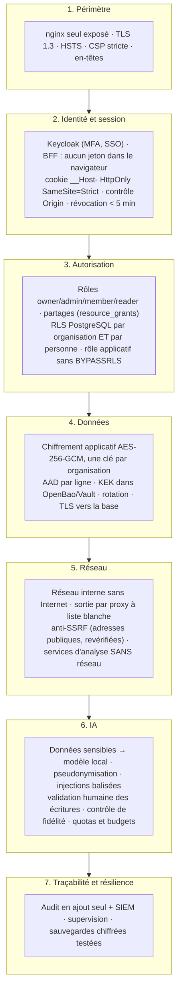
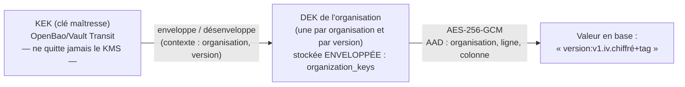

# Architecture de sécurité de Snowfall

Ce document explique **comment** Snowfall se protège, couche par couche, et
**où** c'est codé. Le registre des menaces (ce qui peut arriver, et la mesure
qui y répond) est dans [../security/THREAT_MODEL.md](../security/THREAT_MODEL.md),
les exigences dans [../security/SECURITY_BASELINE.md](../security/SECURITY_BASELINE.md),
l'analyse d'impact RGPD dans [../security/AIPD.md](../security/AIPD.md).

Principe directeur : **défense en profondeur**. Aucune couche n'est supposée
infaillible ; chacune limite ce qu'obtiendrait un attaquant qui a franchi la
précédente.

---

## 1. Périmètre

| Mesure | Détail | Où |
|---|---|---|
| Un seul service exposé | nginx publie 443 (et 80, qui redirige). API, base, KMS : réseau interne seulement | `compose.prod.yaml` |
| TLS | TLS 1.3 uniquement, pas de tickets de session ; HSTS 2 ans, `preload` | `infra/nginx/snowfall.conf`, `security-headers.conf` |
| CSP | `default-src 'none'`, scripts et styles de la même origine seulement, `frame-ancestors 'none'`, **Trusted Types** exigés, rapports vers `/api/security/csp-report` | `infra/nginx/security-headers.conf` |
| Isolation de l'origine | COOP `same-origin`, CORP `same-origin`, COEP `require-corp`, `X-Frame-Options: DENY`, `Referrer-Policy: no-referrer`, Permissions-Policy (micro seulement) | idem |
| Prototypes générés (`/artifact/`) | CSP distincte : aucun réseau (`connect-src 'none'`), aucun formulaire, cadrés seulement par l'application | `infra/nginx/artifact-headers.conf` |
| En-tête interne | `X-Snowfall-Internal` vidé par nginx : un appel externe ne peut pas se faire passer pour un appel interne | `snowfall.conf` |
| Limites | Corps ≤ 26 Mo (nginx ; chaque route garde sa limite : 25 Mo pour les bases et l'import, 10 Mo pour les pièces jointes) ; 300 requêtes/min par défaut, limites plus basses sur la connexion (20/min), les validations, les vérifications de clés (10/min) | `server.ts` (`@fastify/rate-limit`, Redis si plusieurs instances) |

## 2. Identité et session

| Mesure | Détail | Où |
|---|---|---|
| Fournisseur d'identité | Keycloak : MFA, politique de mot de passe, fédération SSO, organisations ; HTTPS obligatoire, hostname strict en production | `infra/keycloak`, `compose.prod.yaml` |
| BFF | L'API est un client OIDC **confidentiel** (code + PKCE, state, nonce). Les jetons restent côté serveur, **scellés** (chiffrés) en base | `auth/oidc.ts`, `auth/session-store.ts` |
| Cookie | `__Host-` (Secure, Path=/, sans Domain), `HttpOnly`, `SameSite=Strict` ; identifiant aléatoire dont seule l'**empreinte** est stockée | `server.ts` (`cookieNames`) |
| Durée | Inactivité 30 min, maximum 10 h ; revalidation auprès de Keycloak toutes les 4 min | `session-store.ts` |
| Déconnexion globale | Back-channel logout OIDC (jeton signé vérifié : événement, pas de nonce, sid ou sub, jti) | `auth/oidc.ts` |
| CSRF | Toute méthode modifiante exige `Origin` = origine de l'application (en plus de SameSite=Strict) ; refus journalisé `security.csrf_rejected` | `server.ts` |
| Accès machine | Clés d'API (`/v1`) : aléa 256 bits, seule l'empreinte SHA-256 est gardée, agit au nom de l'administrateur créateur tant qu'il l'est ; jeton SCIM séparé pour `/scim/v2` | `apikeys/`, `routes/public-api.ts`, `routes/scim.ts` |

## 3. Autorisation et cloisonnement

**Deux verrous indépendants** : le code vérifie les droits, **et** la base refuse
d'elle-même ce qui n'appartient pas au contexte.

| Mesure | Détail | Où |
|---|---|---|
| Rôles | `owner`, `admin`, `member`, `reader` (lecture seule : `canWrite` faux) | `auth/auth.ts`, `routes/kit.ts` |
| Partages | Agents, bases, prompts, compétences partagés à une personne, un groupe ou l'organisation (`resource_grants`) | `sharing/`, `shares/` |
| **RLS** | Chaque table porte une politique : par **organisation** (`app.organization_id`) ou par **propriétaire** (`app.organization_id` + `app.user_id`). `FORCE ROW LEVEL SECURITY` : même le propriétaire du schéma y est soumis | `db/schema.ts` (`tenantPolicy`), migrations |
| Contexte par transaction | `set_config(…, true)` : le contexte ne vaut que pour la transaction, rien ne fuit vers la requête suivante sur la même connexion | `db/tenant.ts` |
| Rôles PostgreSQL | `snowfall_app` (application : `NOSUPERUSER`, **`NOBYPASSRLS`**, droits table par table, délai de requête 30 s) ; `snowfall_migrator` (schéma) ; `snowfall_backup` (lecture seule, `BYPASSRLS` pour la sauvegarde) ; `snowfall_monitor` (`pg_monitor`) | `scripts/db-setup.ts`, `scripts/db-grants.ts` |
| Vérification du schéma | `npm run db:check` compare la base réelle au schéma attendu (politiques, contraintes, droits) | `db/schema-check.ts` |

## 4. Protection des données

### 4.1 Chiffrement applicatif (enveloppe)

- **Algorithme** : AES-256-GCM (chiffrement authentifié) ; format `v1.<iv>.<chiffré+tag>` (`crypto/envelope.ts`).
- **Une DEK par organisation**, versionnée (`crypto/keyring.ts`) ; la valeur
  stockée commence par la version (`2:v1.…`).
- **AAD** (données associées) : lient chaque chiffré à son contexte
  (organisation, personne, identifiant de ligne, colonne ; pour un fournisseur
  personnalisé, aussi son adresse). Un chiffré **copié** vers une autre ligne,
  une autre organisation ou une adresse modifiée **ne se déchiffre plus**.
- **KEK** : en production dans OpenBao/Vault (moteur Transit, clé dérivée par
  contexte), accès par AppRole (jeton court, renouvelé, jamais écrit sur disque) ;
  en développement, dérivée de `SNOWFALL_MASTER_KEY` par HKDF-SHA256 (`crypto/vault.ts`).
- **La base refuse le clair** : chaque colonne chiffrée a une contrainte de
  format (`…_encrypted_check`).
- **Rotation** : `npm run keys:rotate` rechiffre toutes les colonnes inventoriées
  avec la dernière version de DEK ; `-- --kek` change de KEK. L'inventaire
  (`ENCRYPTED_TABLES`, `crypto/rotation.ts`) est vérifié par un test qui échoue
  si une colonne chiffrée de la migration n'y figure pas.
- Détail colonne par colonne : [DONNEES.md](DONNEES.md).

### 4.2 En transit

| Lien | Protection |
|---|---|
| Navigateur → nginx | TLS 1.3 |
| API → PostgreSQL, Keycloak → PostgreSQL, sauvegarde → PostgreSQL | TLS 1.3, `verify-full` (AC privée), SCRAM-SHA-256 |
| API → OpenBao | HTTPS (AC privée) |
| API → fournisseurs, MCP, web | HTTPS via le proxy de sortie |
| nginx → API, API → services internes | HTTP sur le réseau interne isolé ; sockets Unix pour sandbox/ocr/decision |

### 4.3 Secrets

- Production : injectés par le gestionnaire de secrets ; fichiers Docker
  `secrets` en lecture seule (`vault_secret_id`, mots de passe des sauvegardes,
  de la supervision…), jamais en variable quand c'est évitable.
- Clés d'API des fournisseurs saisies dans l'interface : chiffrées, jamais
  renvoyées (4 derniers caractères au plus), jamais dans l'audit.
- Journaux : en-têtes `cookie` et `set-cookie` masqués par le journaliseur.

## 5. Réseau et isolation

| Mesure | Détail | Où |
|---|---|---|
| Réseau interne | `backend` déclaré `internal: true` : aucune route vers Internet | `compose.prod.yaml` |
| Proxy de sortie | Squid : refuse toute destination interne (RFC 1918, lien local, métadonnées cloud, IPv6 privées…) ; n'autorise que les domaines listés : plateforme (`allowed-domains.txt`), pages des bases (`knowledge-domains.txt`), moteurs de recherche (seulement depuis SearXNG), serveurs MCP (CONNECT) ; ni cache, ni `X-Forwarded-For`, ni `Via` | `infra/egress/squid.conf` |
| Anti-SSRF applicatif | Toute adresse saisie (lien, connecteur MCP, fournisseur personnalisé) : HTTPS, publique, sans identifiants ni port inhabituel ; noms résolus et revérifiés avant chaque appel ; redirections refusées ou revérifiées (3 au plus) | `knowledge/safe-fetch.ts`, `mcp/client.ts`, `llm/custom-providers.ts` |
| Conteneurs durcis | `read_only`, `cap_drop: ALL`, `no-new-privileges`, utilisateurs non root, `tmpfs` | `compose.prod.yaml` (`x-hardened`) |
| Services d'analyse | sandbox, ocr, decision : `network_mode: none`, **gVisor** (`runsc`, exigé : le serveur refuse de démarrer sans), limites CPU/mémoire/processus, socket Unix réservé à un groupe | `compose.prod.yaml`, `apps/sandbox`, `apps/ocr`, `apps/decision` |
| Antivirus | Chaque fichier déposé (pièce jointe, base, compétence) analysé par ClamAV avant usage | `security/antivirus.ts` |
| Images épinglées | Toutes les images par empreinte `@sha256:` ; dépendances npm épinglées, ≥ 14 jours, `npm audit` en CI, SBOM CycloneDX | `compose*.yaml`, `.github/workflows/ci.yml` |

## 6. Sécurité propre à l'IA

| Risque | Mesure | Où |
|---|---|---|
| Données sensibles envoyées à un tiers | Détection locale déterministe (NIR avec clé, IBAN, carte avec Luhn, santé visant une personne) **avant** tout envoi ; si détecté : modèle local exigé, sinon refus | `security/sensitive.ts` |
| Données personnelles | Pseudonymisation **réversible** facultative : e-mails, téléphones, adresses, noms, identifiants deviennent `[PERSONNE_1]`, `[EMAIL_1]`… avant l'envoi ; les vraies valeurs sont remises avant l'affichage et avant un outil ; la correspondance ne vit qu'en mémoire, le temps de l'appel. Ce n'est pas une anonymisation (un nom non repéré part en clair) | `privacy/pseudonymize.ts` |
| Base confidentielle | Embeddings et réponses **locaux** seulement ; jamais d'outil MCP ni de fournisseur externe | `knowledge/service.ts`, `server.ts` |
| Injection de prompt (documents, pages, résultats d'outils) | Défense **structurelle** : contenus balisés comme données, aucun droit accordé par un contenu, validation humaine des écritures ; détection en plus (avertissement au modèle et sur la carte de validation) | `security/injection.ts`, `agent/injection-guard.ts`, `security/neutralize.ts` |
| Actions non voulues | Outils « écriture » (MCP, enregistrer dans une base) : **validation humaine** obligatoire, run en pause | `agent/catalog.ts`, `server.ts` |
| Outil MCP modifié après approbation | Empreinte (nom, description, schéma) : changement → outil bloqué | `mcp/client.ts` (`toolFingerprint`) |
| Exfiltration par le code d'un agent | Sandbox sans réseau, gVisor, dossier neuf, tout tué à la fin | `agent/code-tool.ts`, `apps/sandbox` |
| Chiffres inventés dans un document généré | Contrôle de fidélité (nombres absents des sources signalés à l'humain) | `agent/fidelity.ts` |
| Exfiltration par un contenu piégé (« règle de deux ») | Un agent qui a lu un contenu non fiable ET des données internes doit obtenir l'accord humain pour chaque appel sortant (web, MCP), avec ce qui va sortir exactement | `agent/exposure.ts` |
| Coûts | Quotas par fournisseur, budgets mensuels (organisation, membre), quotas d'outils | `workspace/settings.ts` |
| Clés des modèles | Trois niveaux (personnelle, organisation, plateforme), clés personnelles désactivées par défaut, caches rangés par empreinte | `llm/keys.ts`, `llm/registry.ts` |

## 7. Traçabilité, supervision, résilience

| Mesure | Détail | Où |
|---|---|---|
| Journal d'audit | Table `audit_events` en **ajout seul** : le rôle applicatif n'a que `INSERT`, des déclencheurs interdisent UPDATE, DELETE, TRUNCATE. Jamais de contenu ni de secret dans les détails | `audit/audit.ts`, migration `security_enforcement` |
| SIEM | Copie JSON sur la sortie standard et/ou webhook HTTPS (JSON ou Splunk HEC), file bornée ; la base reste la référence | `audit/audit.ts` |
| Supervision | Prometheus (métriques de l'API protégées par jeton), Alertmanager, Loki + Alloy (journaux), Grafana, postgres-exporter | `infra/monitoring` |
| Traces IA | Langfuse auto-hébergé (facultatif) | `infra/langfuse` |
| Sauvegardes | Quotidiennes, chiffrées (age) pour une clé hors site et une clé de test, 35 jours, copie hors site ; restauration testée chaque mois sans réseau | `infra/backup` |
| Rétention | Durées de conservation par organisation (`organization_retention`) ; journal d'audit purgé au-delà de `AUDIT_RETENTION_DAYS` (365 jours par défaut, 90 au minimum, imposé aussi par un déclencheur), par le seul rôle de migration, avec archive JSONL possible | `scripts/audit-purge.ts` |
| Réponse aux incidents | Procédures | [../operations/INCIDENT_RESPONSE.md](../operations/INCIDENT_RESPONSE.md) |

## 8. Vérifier que tout cela tient

- **Tests** : chemins d'attaque testés (accès d'une autre organisation, d'un
  membre, d'un lecteur ; adresses internes ; clé en clair refusée par la base ;
  AAD déplacée…). API : `npm run check:api` ; web : `npm test`, `npx playwright test`.
- **Mutations** : pour chaque fonctionnalité sensible, on casse volontairement
  une protection et on vérifie qu'un test échoue (résultats dans les fiches de
  `docs/learning`).
- **Scripts d'attaque** : `scripts/sandbox-attack.sh` (isolation de la sandbox).
- **Preuves** : [../operations/PREUVES.md](../operations/PREUVES.md) ; périmètre de
  test d'intrusion : [../security/PENTEST_SCOPE.md](../security/PENTEST_SCOPE.md).

## 9. Limites connues (résiduels)

| Limite | Effet | Traitement |
|---|---|---|
| Hors proxy (développement), le DNS peut changer entre la vérification d'une adresse et la connexion | SSRF théorique en développement | En production, le proxy refuse lui-même les adresses internes |
| Les embeddings des bases utilisent les clés de la plateforme, pas celles saisies dans l'interface | Coût porté par la plateforme | Documenté (RUNBOOK §49) |
| Recherche en mémoire après déchiffrement | Mémoire de l'API proportionnelle à la base interrogée | Bornes : 200 sources et 50 000 passages par base (`knowledge/store.ts`) |
| Détection d'injection et de données sensibles par règles | Faux négatifs possibles | Défense structurelle d'abord ; jeux de mesure tenus à part |
